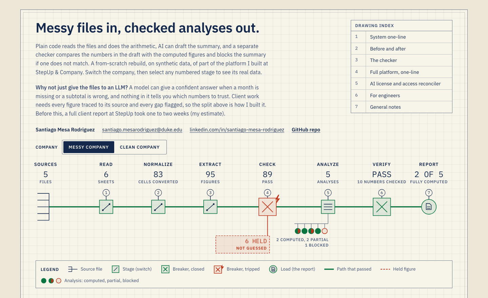
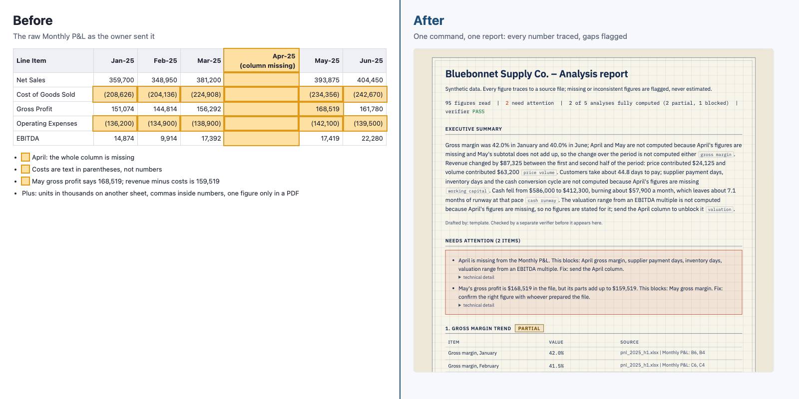

# Small Business Analytics Engine

[](https://github.com/santiagomesa200/small-business-analytics-engine/actions/workflows/gate.yml)

An analysis engine for a small company's messy spreadsheets and PDFs. Plain code does the reading and arithmetic, AI can draft the summary, and a separate checker compares the numbers in the draft with the computed figures and blocks the summary if one does not match. This is a from-scratch rebuild, on synthetic data, of part of the platform I built at StepUp & Company. The checker's limits are listed under [Decisions and tradeoffs](#decisions-and-tradeoffs).

One command reads the files, pulls every figure with its source, flags what is missing instead of guessing, runs five analyses and writes a report an owner can act on.

[](https://santiagomesa200.github.io/small-business-analytics-engine/)

Live site: https://santiagomesa200.github.io/small-business-analytics-engine/

## Why this exists

**The need.** At StepUp, owners sent spreadsheets and PDFs that did not agree with each other, and a full client report took one to two weeks (my estimate).

**What the files look like.** A small business owner's financial data lives in a P&L workbook, a balance sheet export, an aging report and a bank PDF. Headers differ between files, some numbers are in thousands, negatives appear in parentheses, a month is missing, a subtotal is typed wrong. A consultant spends days cleaning this before any analysis starts, and the owner cannot tell which numbers were assumed.

**Why not hand the files to an LLM?** A model can give a confident answer even when a month is missing or a subtotal does not add up, and nothing in the answer tells you which numbers to trust. For work a client acts on, every figure has to trace to its source and every gap has to be flagged, not filled.

**So the split.** Each step goes where it can be checked: code for reading and arithmetic, AI only for prose written from finished numbers, and the checker before the report is written, so a draft with a wrong number never reaches the owner. [One real AI draft and its verdict](docs/ai-draft-example/) are in the repo.

**It carries over.** The file reader, the number parser and the checker pattern were reused for a second task, the license and access reconciler built from IEM's posting (see below).

## Run it

Needs Python 3.12 or newer. One command sets up a virtual environment from the pinned `requirements-dev.txt` (which includes `requirements.txt`) and runs the whole check:

```
make check                                 # venv, pinned install, lint, types, security, tests, gate
```

Or step by step:

```
python3 -m venv .venv && . .venv/bin/activate   # later commands in this README assume it is active
pip install -r requirements-dev.txt        # exact versions, Python 3.12+; includes requirements.txt
python scripts/make_sample_data.py         # writes synthetic inputs to data/sample/
python run.py data/sample                  # writes outputs/sample/report.md, report.html, figures.csv
python -m engine.gate                      # 110 tests plus contract checks; non-zero exit on any failure
```

`make check` runs ruff (lint and format), mypy on `engine/`, bandit, pip-audit on the pinned requirements, gitleaks when installed (CI scans the full git history), and the gate: the tests with a 90% coverage floor, hypothesis property tests for the verifier and the number parser, and the contract checks. CI runs the same on every push. The gate always uses the offline template drafter, never a model.



## How it works

```
data/<folder>/            xlsx, csv, pdf
  engine/read.py          every file into plain rows (Sheet); nothing interpreted
  engine/normalize.py     header aliases, "in thousands", "(1,234)" negatives, month labels
  engine/extract.py       every figure into the Ledger with file | sheet | cell
  engine/checks.py        subtotals, balance sheet, cross-file agreement; a failed check sets the figure to None
     v
Ledger (engine/model.py)  each figure is a value, or None with a named reason
  engine/analyses.py      five analyses; a flagged input blocks only what depends on it
  engine/summarize.py     draft summary: Claude if ANTHROPIC_API_KEY is set, otherwise a template
  engine/verify.py        separate fixed-rule checker; a failed check blocks the summary
  engine/report.py        report.md, report.html, figures.csv
```

`engine/pipeline.py` runs these steps in order and `run.py` is the command line. `engine/plain.py` holds the plain-English wording. `engine/licenses.py` is the second task: it reuses `read`, `normalize` and the verifier's helpers. `engine/gate.py` is the release gate.

Analyses: gross margin trend, price vs volume effect on revenue, working capital (DSO, DPO, DIO), cash runway, and a valuation range from an EBITDA multiple with the assumptions written out.

**Data model.** `Sheet` (plain rows from one file) -> `Ledger` (every figure is a value or `None`, with a source cell and a named reason when `None`) -> `Result` (metrics with units and a status) -> `Verdict` on the summary.

**One figure, traced.** May gross profit sits in `pnl_2025_h1.xlsx`, Monthly P&L, cell E6. `normalize.py` reads it as a number, `extract.py` puts it in the ledger with that source, `checks.py` finds revenue minus cost of goods is 159,519 not 168,519 and sets it to `None`, `analyses.py` marks that month not computed (the analysis is partial), the template says so in one sentence, and `verify.py` checks that sentence. Sheet 6 of the site draws this from a real run.

## Repo layout

| Path | What is in it |
|---|---|
| `run.py` | Command line: `python run.py <folder> [out_dir] [--mode licenses]` |
| `engine/` | One module per pipeline step (see How it works), plus the release gate |
| `tests/` | pytest suite with hypothesis property tests; run by the gate |
| `scripts/` | Generators for the synthetic inputs, the rejected-summary example, the before/after image and the site |
| `data/` | Synthetic inputs: `sample/` (three planted problems), `clean/` (same company, no problems), `licenses/` (seat exports, roster, usage log, approvals) |
| `outputs/` | Committed results of those runs; the gate fails if a fresh run differs |
| `docs/` | GitHub Pages site (`index.html`, `site-data.json`, `reports/`, `fonts/`), the case study, images, and one real AI draft with its verdict |
| `Makefile`, `.github/workflows/gate.yml` | `make check` locally; CI runs the same steps on every push |
| `requirements*.txt` | Pinned runtime, dev (tests and checks), and the optional Claude client |
| `ruff.toml`, `mypy.ini`, `bandit.yaml`, `.coveragerc` | Lint, type, security and coverage settings |

## What you'll see

The sample company, "Bluebonnet Supply Co.", has three problems planted on purpose: the April column is missing from the P&L, the May gross profit subtotal is off by $9,000, and the opening cash balance and line of credit exist only in the PDF.

```
Files read:         5 (ar_aging_2025-06-30.csv, balance_sheet_2025-06-30.csv, bank_statement_summary.pdf, pnl_2025_h1.xlsx, sales_by_product.csv)
Figures extracted:  95 (89 usable, 6 flagged)
Issues flagged:     6
Analyses:           2 computed, 2 partial, 1 blocked
  - gross_margin     partial
  - price_volume     computed
  - working_capital  partial
  - cash_runway      computed
  - valuation        blocked
Verifier:           PASS (drafter: template)
Runtime:            0.01s
Wrote outputs/sample/report.md, report.html, figures.csv
```

From `outputs/sample/report.md` (the six flagged figures are grouped into two causes):

```
Gross margin was 42.0% in January and 40.0% in June; April and May are not computed because April's
figures are missing and May's subtotal does not add up, so the change over the period is not computed
either [gross_margin]. ...
Cash fell from $586,000 to $412,300, burning about $57,900 a month, which leaves about 7.1 months of
runway at that pace [cash_runway]. The valuation range from an EBITDA multiple is not computed because
April's figures are missing, so no figures are stated for it; send the April column to unblock it [valuation].

## Needs attention (2 items)
- April is missing from the Monthly P&L. This blocks: April gross margin, supplier payment days, inventory
  days, valuation range from an EBITDA multiple. Fix: send the April column.
  ...
- May's gross profit is $168,519 in the file, but its parts add up to $159,519. This blocks: May gross
  margin. Fix: confirm the right figure with whoever prepared the file.
  ...
```

Each analysis table also has a Source column (file, sheet, cells).

Gross margin is partial: the four clean months compute and the two flagged months say why they did not. Working capital is partial: DSO is computed (44.8 days) because the sales file is complete, while DPO and DIO need H1 COGS, which has the April gap.

**Clean company, side by side.** The same pipeline on a clean version of the data (`python scripts/make_sample_data.py data/clean --clean`, then `python run.py data/clean outputs/clean`) has no flags and all five analyses compute. Compare `outputs/sample/report.md` (messy) with `outputs/clean/report.md` (clean):

```
Figures extracted:  95 (95 usable, 0 flagged)
Issues flagged:     0
Analyses:           5 computed, 0 partial, 0 blocked
Verifier:           PASS (drafter: template)
```

**A rejected summary.** `outputs/examples/` holds a draft with a fabricated price effect and a real number (DSO) pasted into the runway sentence, plus the verifier's output (`python scripts/make_rejection_example.py` regenerates it):

```
Verifier result: FAIL - summary blocked
- number $31,000 is not a figure of price_volume: ...
- number 44.8 days is not a figure of cash_runway: ...
```

**Running with Claude.** The committed reports use the template drafter. One real Claude draft of the sample summary, sent through the Claude Code CLI and checked by the verifier, is in [docs/ai-draft-example/](docs/ai-draft-example/): the verifier passed it, and the README there notes a limit it has. To use Claude: `pip install -r requirements-llm.txt`, `export ANTHROPIC_API_KEY=...`, then `python run.py data/sample`. The same verifier checks the model's text; if it fails, the report says the summary was blocked. `ANTHROPIC_MODEL` overrides the default model.

## Second task from IEM's posting: AI license and access reconciler

I built this after reading IEM's posting: a first version of the license and access task the role owns, on synthetic data. Same building blocks, new task, pointed at seats instead of spreadsheets: it matches vendor seat exports to an HR roster, a usage log and an approvals list, and finds seats held by people who left, seats unused for 30+ days, duplicate seats, access with no approval, seats whose usage is unknown (no usable log entry, which is not the same as unused), and seats that match nobody (listed, no match assumed). Savings count only seats with a known cost. The summary is always written by a template, and the same verifier pattern checks it.

```
python scripts/make_license_data.py        # synthetic data in data/licenses/
python run.py data/licenses --mode licenses  # outputs/licenses/report.md, report.html, actions.csv
```

Run log: 83 seats, 21 flagged (6 terminated holders, 1 duplicate, 10 unused, 3 unapproved, 1 unresolvable), $522 a month if reclaimed, verifier PASS. It is sheet 5 of the site. The assessment date is read from the roster title (or pass `asof=` to `engine.licenses.reconcile`).

## Decisions and tradeoffs

**Flags, not guesses.** A missing April could be filled with an average, and the report would look complete. It would also hide the one thing the owner most needs to know. When a subtotal does not add up, the engine cannot tell whether the total or one of its parts is wrong. It flags the total only and leaves the parts in use, so an analysis that needs only the parts still runs, and one that needs the total refuses. When two files disagree, both sides are flagged.

**Where AI is used.** Only to draft the five-sentence summary (Claude, if `ANTHROPIC_API_KEY` is set; otherwise a deterministic template). Writing prose from computed numbers is a good fit for a language model.

**Where AI is deliberately not used.** Reading numbers, checking subtotals and doing the arithmetic. Those have exact right answers, so they are plain code that can be tested and repeated.

**Why a separate checker.** The drafter never grades its own work. `engine/verify.py` is independent code with fixed rules: one sentence per analysis, none repeated, each analysis cited exactly once; every number must equal a figure from the analysis that sentence cites, at the precision shown and with the same unit ($, %, days, months, pp, x), so a real dollar figure cannot pass as months; a bare year is allowed only if it is one of that analysis's period labels; blocked analyses may not have numbers stated for them. It checks the value and unit of the numbers it finds. It does not check numbers written as words, numbers joined to letters such as Q1 or FY2026, month labels like 2025-04, which figure a number belongs to, or whether a sentence says up or down. If the check fails, the report shows that the summary was blocked and why, not the draft.

**Release gate.** `python -m engine.gate` runs the tests and contract checks: every figure has a source, every gap has a named reason, every flag appears in the report, runs are repeatable, and no imputation calls exist in the code.

**What I would measure in production.**
- Time saved: hours from file drop to first report, against the consultant baseline.
- Issues caught: flagged figures per run, and how many a person confirmed as real.
- Analyses blocked: how often and why. A high rate on one file type means fixing the source, not the engine.
- Verifier rejections: how often the drafter's text fails the check.

## For engineers

- **Stack:** Python 3.12+, pandas, openpyxl, pypdf, all pinned in `requirements.txt` (pytest and the other checks in `requirements-dev.txt`). The site is one static HTML file whose data is written by `scripts/make_site.py`.
- **Tests:** each stage, each seeded problem, regression tests for bugs found in review, filed with the behavior they cover, and the contract gate (`engine/gate.py`), which also fails if the site data or any committed report or CSV differs from a fresh offline run.
- **Failure behavior:** bad figures become `None` with a reason; a file with a missing column, no rows or unreadable content is logged and skipped; zero denominators and non-finite numbers are not computed; a figure that appears twice is flagged, not overwritten. License mode does the same for a missing, unreadable or headerless input file. Neither mode raises on bad data.

## What this is not

- Not real client data. Every file is synthetic and generated by `scripts/make_sample_data.py` and `scripts/make_license_data.py`.
- Not production software. No authentication, no file-format coverage beyond this sample's shapes, no handling of multi-year data or currency.
- Not financial advice. The valuation uses illustrative multiples, not market comparables.

## Part of a bigger system

This repo rebuilds one slice of a platform I built at StepUp & Company, a three-person advisory firm I co-founded (January 2025 – November 2026). The real platform is proprietary, so nothing here is its code, screens or data. It is a from-scratch reconstruction with a fictional company, written so you can run it.

```
Full platform at StepUp                                        This repo
------------------------------------------------------------   -------------------------
Client spreadsheets and PDFs                                    yes, synthetic
  -> Ingestion: read, clean, extract every figure with source   yes (the core of this repo)
  -> Consistency checks; missing figures flagged, not guessed   yes
  -> Company database with one controlled write path            no
  -> 46 analyses (quality of earnings, working                   5, simplified
     capital, pricing, valuation, forecasting, ...)
  -> Release gate: 495 database tests and a                     110 tests and a gate
     1,198-check correctness gate that blocks a bad release
  -> Report, with an AI draft checked by a second model         yes, but the checker is fixed-rule code, not a model
```

The one-page story of the real platform is in [docs/case-study.md](docs/case-study.md). In the real platform, this approach took a full client report from one to two weeks to about three days (my estimate). The numbers in the table above are self-reported from my own project records. I designed the process and rules and built it with AI coding tools.

## License

MIT, see LICENSE.
